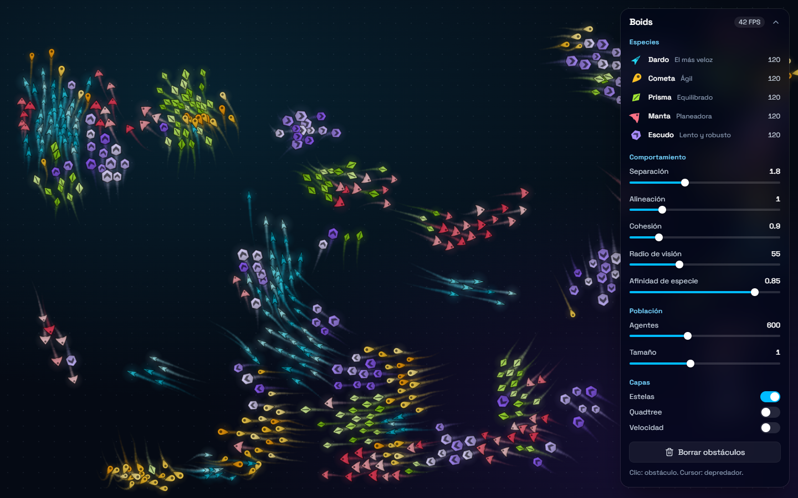
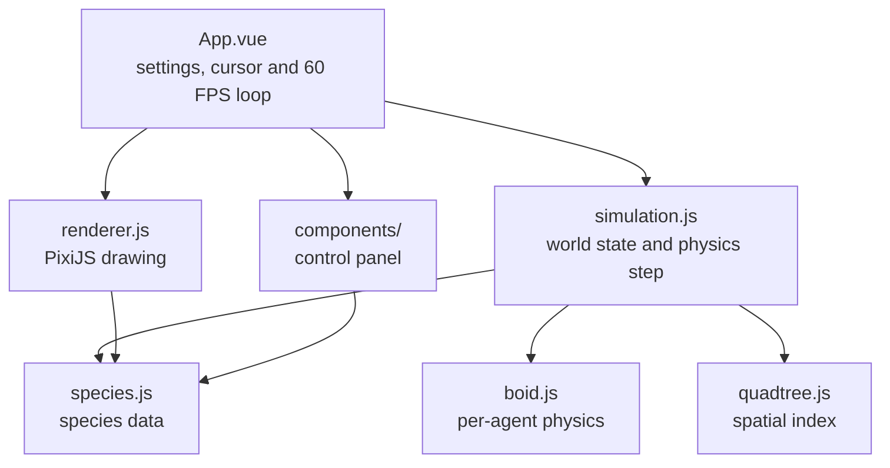
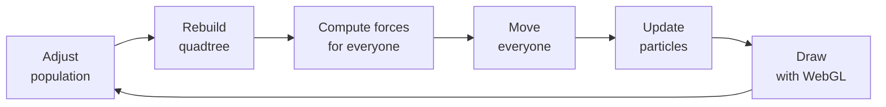

<div align="center">

# Boids

**A 2D artificial-life ecosystem where five species flock together, dodge each other and flee from your cursor.**

[](https://ganeshads.github.io/boids/)




</div>

## Highlights

- **Up to 1,500 agents at 60 FPS**, rendered with WebGL through PixiJS `ParticleContainer`.
- **Quadtree spatial index** so each agent only checks nearby neighbours instead of everyone.
- **Five species** with their own silhouette, color, speed and agility, and a tunable *species affinity* that makes them form separate flocks.
- **Interactive**: agents flee from your cursor, clicks place obstacles, and every rule can be tuned live.
- **Clean architecture**: the physics knows nothing about the browser, and dependencies flow in one direction.

> The in-app interface is in Spanish.

## Quick start

You need [Node.js](https://nodejs.org) 20.19+ or 22.12+.

```bash
git clone https://github.com/GaneshaDS/boids.git
cd boids
npm install
npm run dev
```

Open the URL printed in the terminal, usually http://localhost:5173.

| Command | What it does |
|---|---|
| `npm run dev` | Development server with hot reload |
| `npm run build` | Production build into `dist/` |
| `npm run preview` | Serves that production build locally |

Every push to `main` is built and deployed to GitHub Pages by [`.github/workflows/deploy.yml`](.github/workflows/deploy.yml).

## How to use it

| Action | Effect |
|---|---|
| Move the cursor over the canvas | Agents flee from it as if it were a predator |
| Click on the canvas | Places an obstacle (up to 60) |
| Hover a species in the legend | Highlights it and dims the others |
| Click a species in the legend | Pins that highlight |

The panel also lets you tune the flocking rules, population, size and debug layers (quadtree and velocity vectors).

## The species

Each species is told apart by its **silhouette** and its **color**, so they stay recognisable with color blindness. They also **move** differently, and every individual is born with its own size and hue.

| Species | Silhouette | Color | Speed | Agility | Character |
|---|---|---|:---:|:---:|---|
| **Dardo** (Dart) | Notched arrow | Cyan | ×1.20 | ×1.15 | The fastest |
| **Cometa** (Comet) | Teardrop with tail | Amber | ×1.06 | ×1.35 | The sharpest turner |
| **Prisma** (Prism) | Rhombus | Lime | ×0.96 | ×1.00 | Balanced |
| **Manta** (Manta) | Curved wings | Pink | ×0.86 | ×0.85 | A glider |
| **Escudo** (Shield) | Hexagon | Violet | ×0.72 | ×0.70 | Slow and sturdy |

To add a species, add an entry to `SPECIES` in [`src/species.js`](src/species.js): the engine, the drawing layers and the legend are all generated from that list.

## How the code works

The project separates three responsibilities: **simulating** the world, **drawing** it and **controlling** it.



| File | Responsibility |
|---|---|
| [`src/species.js`](src/species.js) | Silhouette, palette and physics of each species |
| [`src/boid.js`](src/boid.js) | Forces on one agent: flocking, fleeing, obstacles and edges |
| [`src/quadtree.js`](src/quadtree.js) | Finds nearby neighbours without comparing everyone to everyone |
| [`src/simulation.js`](src/simulation.js) | Population, obstacles and one physics step |
| [`src/renderer.js`](src/renderer.js) | Textures and WebGL particle layers |
| [`src/App.vue`](src/App.vue) | Settings, cursor input and main loop |
| [`src/components/`](src/components) | Panel, sliders, switches and legend |

### The frame loop



All forces are computed **before** any agent moves, so no agent reacts to positions another one already updated in the same frame. Time is measured in 60 Hz frames and capped at 3, to avoid huge jumps when you come back from another tab.

### The flocking rules

The behaviour follows Craig Reynolds' boids model (1987). There is no leader and no global plan: the flock emerges from three local rules that each agent applies to the neighbours inside its view radius.

| Rule | The agent tries to… | Setting |
|---|---|---|
| **Separation** | move away from anyone too close | `separation` |
| **Alignment** | fly in the average direction of its neighbours | `alignment` |
| **Cohesion** | move towards the centre of its neighbours | `cohesion` |

Each rule becomes a steering force: the desired velocity minus the current one, limited by the species' agility.

```js
let sx = (dx / length) * this.maxSpeed - this.vx;
let sy = (dy / length) * this.maxSpeed - this.vy;
```

**Affinity** adds the species dimension. With affinity `a`, a neighbour from another species weighs `1 - a` for alignment and cohesion, and repels `1 + a` times more. That is why, at high values, each species forms its own flocks.

```js
const follow = kin ? 1 : 1 - affinity;
const push = kin ? 1 : 1 + affinity;
```

### The quadtree

Comparing every agent with every other grows quadratically: 1,500 agents would mean more than two million comparisons per frame. The quadtree splits the plane into ever-smaller quadrants where agents are dense, and each query discards whole regions outside the view radius at once.

- **Rebuilt every frame**, but it reuses its nodes to avoid garbage-collector pauses.
- **Each query is capped at 120 neighbours**, so a very tight flock cannot blow up the cost.
- **Quadrant visiting order rotates**: always starting from the same one would make that cap favour one side and drift the flock.

Turn on the **Quadtree** layer in the panel to see it in action.

### Rendering

`renderer.js` uses PixiJS `ParticleContainer`, built to draw thousands of sprites cheaply. Layers, from bottom to top:

| Layer | Content | Blending |
|---|---|---|
| Trails | 10 segments per agent, thinner and fainter each time | Additive |
| Glow | A soft halo per agent | Additive |
| Bodies | One layer per species | Normal |
| Overlay | Obstacles, cursor and debug layers | Normal |

Design decisions worth knowing:

- **One source for shapes.** Silhouettes are SVG paths in `species.js`. The renderer paints them into textures and the legend uses them directly, so they can never drift apart.
- **Grayscale textures.** Each agent multiplies the texture by its own tint, so 5 textures produce the whole range of colors, and dark outlines stay dark with any tint.
- **No per-agent allocations in the loop.** Particles are only created or destroyed when the population changes.
- **Vue stays out of the hot loop.** The simulation reads the raw `settings` object, without Vue's reactive proxy, and still sees every slider change.

## Default settings

Initial values live in `settings` in [`src/App.vue`](src/App.vue), and the ranges in [`src/components/ControlPanel.vue`](src/components/ControlPanel.vue).

| Setting | Default | Range |
|---|:---:|:---:|
| Separation | 1.8 | 0 – 5 |
| Alignment | 1 | 0 – 5 |
| Cohesion | 0.9 | 0 – 5 |
| View radius | 55 | 10 – 150 |
| Species affinity | 0.85 | 0 – 1 |
| Agents | 600 (200 on mobile) | 50 – 1500 |
| Size | 1 | 0.6 – 1.6 |

## Author

**Heriberto Ganesha Cortés Valdez** · [LinkedIn](https://www.linkedin.com/in/heriberto-ganesha-cort%C3%A9s-valdez-28bbb72b7/) · [ganesha.dev@outlook.com](mailto:ganesha.dev@outlook.com)

## License

Released under the [MIT License](LICENSE).
