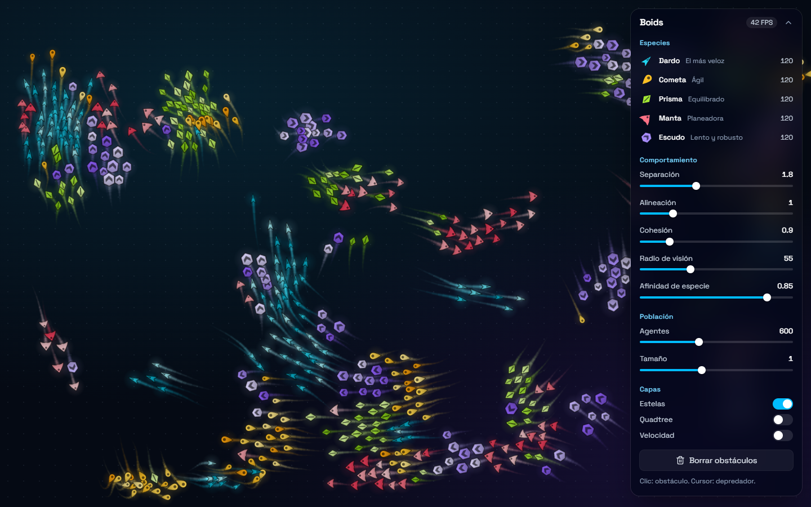
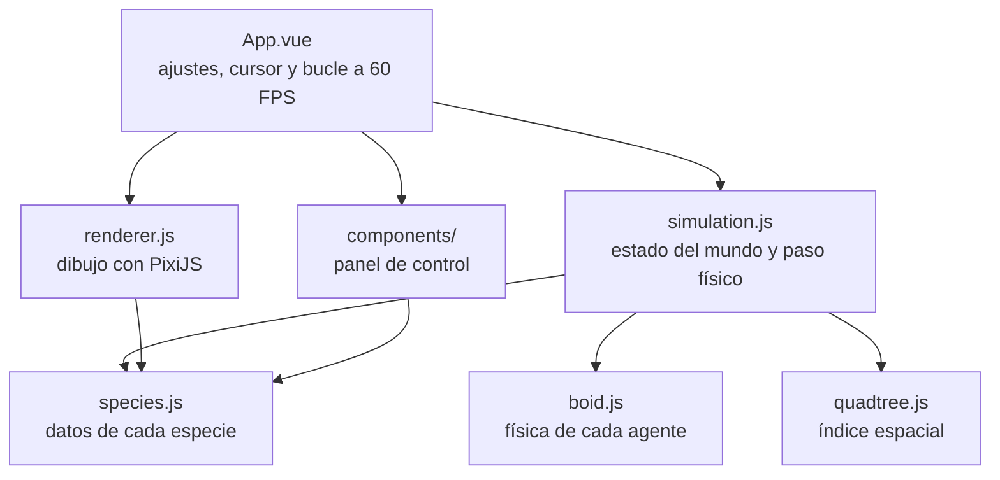
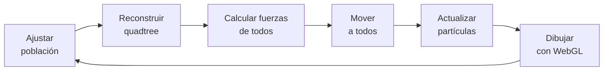

<div align="center">

# Boids

**Un ecosistema de vida artificial en 2D donde cinco especies vuelan en bandadas, se esquivan y huyen de tu cursor.**




</div>

## Inicio rápido

Necesitas [Node.js](https://nodejs.org) 20.19+ o 22.12+.

```bash
npm install
npm run dev
```

Abre la URL que muestra la terminal, normalmente http://localhost:5173.

| Comando | Qué hace |
|---|---|
| `npm run dev` | Servidor de desarrollo con recarga en caliente |
| `npm run build` | Genera la versión de producción en `dist/` |
| `npm run preview` | Sirve localmente esa versión de producción |

## Cómo se usa

| Acción | Efecto |
|---|---|
| Mover el cursor sobre el lienzo | Los agentes huyen de él como de un depredador |
| Clic en el lienzo | Crea un obstáculo (máximo 60) |
| Pasar el cursor por una especie de la leyenda | La resalta y atenúa las demás |
| Clic en una especie de la leyenda | Deja fijo ese resaltado |

En el panel también puedes ajustar las reglas de vuelo, la población, el tamaño y las capas de depuración (quadtree y vectores de velocidad).

## Las especies

Cada especie se distingue por su **silueta** y su **color**, así que se reconocen incluso con daltonismo. También se **mueven** distinto. Además, cada individuo nace con su propio tamaño y tono.

| Especie | Silueta | Color | Velocidad | Agilidad | Carácter |
|---|---|---|:---:|:---:|---|
| **Dardo** | Flecha con muesca | Cian | ×1.20 | ×1.15 | La más veloz |
| **Cometa** | Gota con cola | Ámbar | ×1.06 | ×1.35 | La más ágil al girar |
| **Prisma** | Rombo | Lima | ×0.96 | ×1.00 | Equilibrada |
| **Manta** | Alas curvas | Rosa | ×0.86 | ×0.85 | Planeadora |
| **Escudo** | Hexágono | Violeta | ×0.72 | ×0.70 | Lenta y robusta |

Para añadir una especie basta con agregar una entrada a `SPECIES` en [`src/species.js`](src/species.js): el motor, las capas de dibujo y la leyenda se generan a partir de esa lista.

## Cómo funciona el código

El proyecto separa tres responsabilidades: **calcular** el mundo, **dibujarlo** y **controlarlo**. La física no sabe nada del navegador, y las dependencias van en un solo sentido:



| Archivo | Responsabilidad |
|---|---|
| [`src/species.js`](src/species.js) | Silueta, paleta y física de cada especie |
| [`src/boid.js`](src/boid.js) | Fuerzas de un agente: bandada, huida, obstáculos y bordes |
| [`src/quadtree.js`](src/quadtree.js) | Encuentra vecinos cercanos sin comparar a todos con todos |
| [`src/simulation.js`](src/simulation.js) | Población, obstáculos y un paso de física |
| [`src/renderer.js`](src/renderer.js) | Texturas y capas de partículas WebGL |
| [`src/App.vue`](src/App.vue) | Ajustes, entrada del cursor y bucle principal |
| [`src/components/`](src/components) | Panel, deslizadores, interruptores y leyenda |

### El ciclo de cada fotograma



Las fuerzas de todos los agentes se calculan **antes** de mover a cualquiera. Así, ninguno reacciona a posiciones que otro ya actualizó en ese mismo fotograma. El tiempo se mide en fotogramas de 60 Hz y se limita a 3, para evitar saltos enormes al volver de otra pestaña.

### Las reglas de vuelo

El comportamiento sigue el modelo de boids de Craig Reynolds (1987). No hay un líder ni un plan global: la bandada surge de tres reglas locales que cada agente aplica a los vecinos dentro de su radio de visión.

| Regla | El agente intenta… | Control |
|---|---|---|
| **Separación** | alejarse de quien está demasiado cerca | `separation` |
| **Alineación** | volar en la dirección media de sus vecinos | `alignment` |
| **Cohesión** | acercarse al centro de sus vecinos | `cohesion` |

Cada regla se convierte en una fuerza de dirección: la velocidad deseada menos la actual, limitada por la agilidad de la especie.

```js
let sx = (dx / length) * this.maxSpeed - this.vx;
let sy = (dy / length) * this.maxSpeed - this.vy;
```

La **afinidad** añade la dimensión de especie. Con afinidad `a`, un vecino de otra especie pesa `1 - a` al alinearse y agruparse, y repele `1 + a` veces más. Por eso, con valores altos, cada especie forma sus propias bandadas.

```js
const follow = kin ? 1 : 1 - affinity;
const push = kin ? 1 : 1 + affinity;
```

### El quadtree

Comparar cada agente con todos los demás crece de forma cuadrática: 1500 agentes supondrían más de dos millones de comparaciones por fotograma. El quadtree divide el plano en cuadrantes cada vez más pequeños allí donde hay más agentes, y cada consulta descarta de golpe las regiones que quedan fuera del radio de visión.

- **Se reconstruye en cada fotograma**, pero reutiliza sus nodos para evitar pausas del recolector de basura.
- **Limita cada consulta a 120 vecinos**, de modo que una bandada muy compacta no dispare el coste.
- **Rota el orden de visita de los cuadrantes**: si siempre empezara por el mismo, ese límite favorecería un lado y la bandada se desviaría.

Activa la capa **Quadtree** en el panel para verlo en acción.

### El dibujo

`renderer.js` usa `ParticleContainer` de PixiJS, pensado para dibujar miles de sprites con muy poco coste. Las capas, de abajo arriba:

| Capa | Contenido | Mezcla |
|---|---|---|
| Estelas | 10 segmentos por agente, cada vez más finos y tenues | Aditiva |
| Brillo | Un halo suave por agente | Aditiva |
| Cuerpos | Una capa por especie | Normal |
| Superposición | Obstáculos, cursor y capas de depuración | Normal |

Algunas decisiones que conviene conocer:

- **Una sola fuente para las formas.** Las siluetas son trazados SVG en `species.js`. El renderer los pinta en texturas y la leyenda los usa directamente, así que nunca pueden diferir.
- **Texturas en escala de grises.** Cada agente multiplica la textura por su propio tono, de modo que 5 texturas dan lugar a toda la variedad de color. El contorno y la marca oscuros siguen oscuros con cualquier tono.
- **Sin asignaciones por agente en el bucle.** Las partículas solo se crean o destruyen cuando cambia la población.
- **Vue fuera del bucle crítico.** La simulación lee el objeto original de `settings`, sin el proxy reactivo de Vue, y aun así ve cada cambio de los deslizadores.

## Valores predeterminados

Los valores iniciales están en `settings`, en [`src/App.vue`](src/App.vue), y los rangos en [`src/components/ControlPanel.vue`](src/components/ControlPanel.vue).

| Ajuste | Inicial | Rango |
|---|:---:|:---:|
| Separación | 1.8 | 0 – 5 |
| Alineación | 1 | 0 – 5 |
| Cohesión | 0.9 | 0 – 5 |
| Radio de visión | 55 | 10 – 150 |
| Afinidad de especie | 0.85 | 0 – 1 |
| Agentes | 600 (200 en móvil) | 50 – 1500 |
| Tamaño | 1 | 0.6 – 1.6 |
